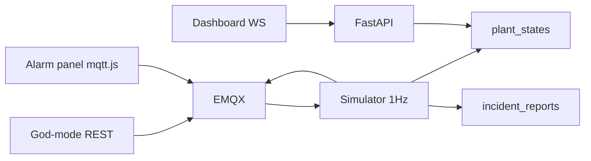
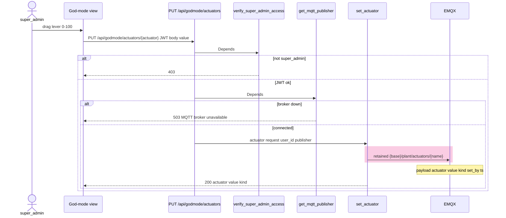
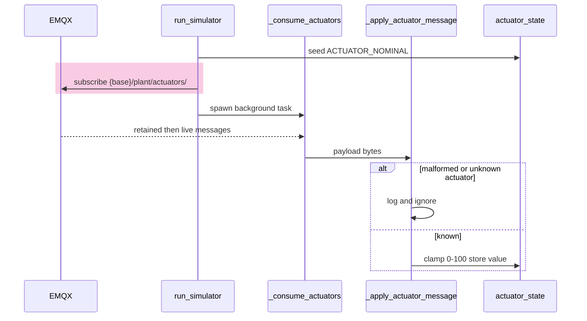
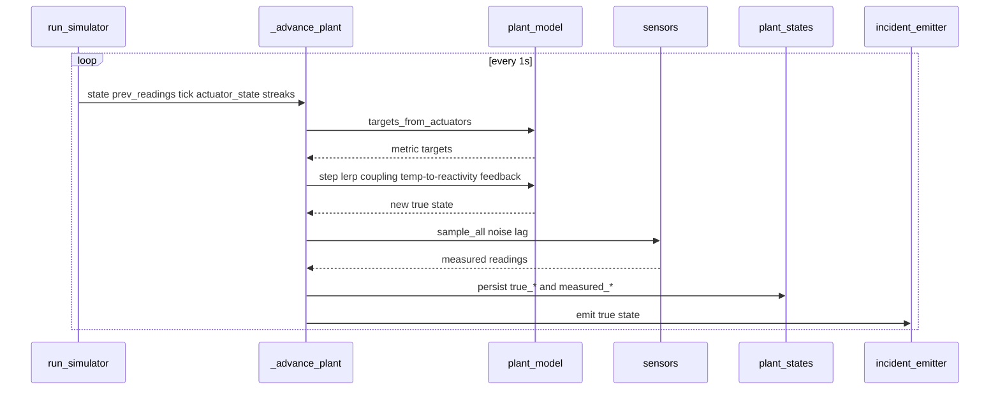
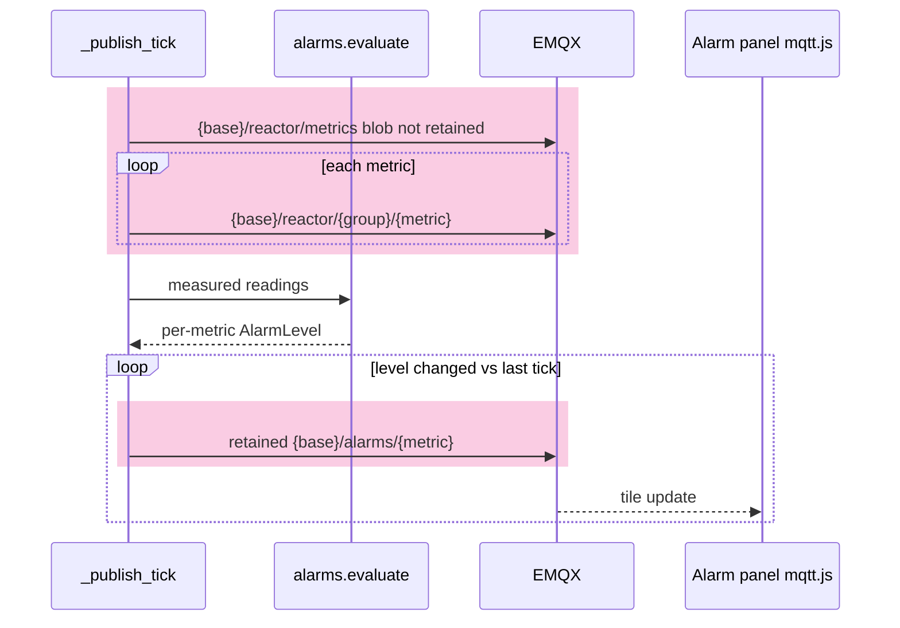
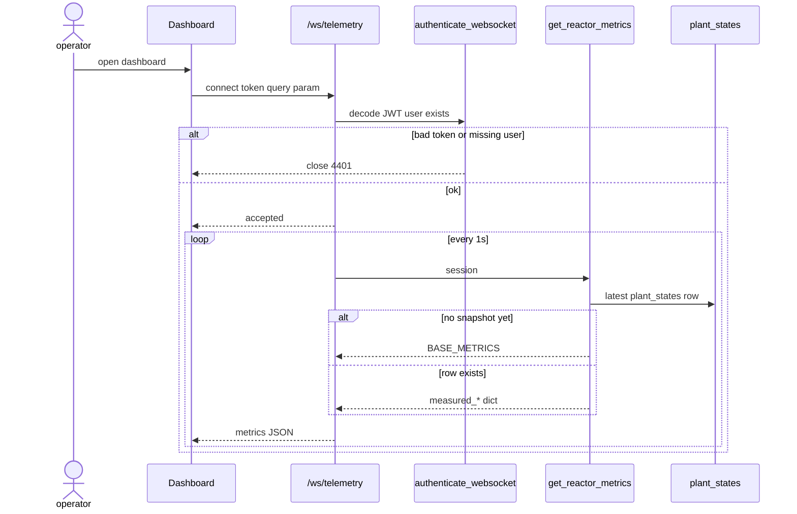
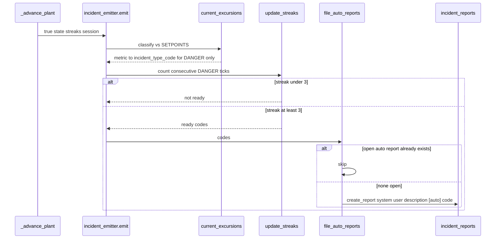

# Phase 4 sequences (as-built)

How the plant actually runs after Phase 4 of [roadmap.md](roadmap.md).
Six small sequences, not one end-to-end sketch: REST publishes a setpoint; a
**separate simulator process** integrates it on the next 1Hz tick; incidents
are a side effect of true state, not the driver.

Client is an actor only (God-mode REST, `/ws/telemetry`, mqtt.js alarm panel).
Phase 5 SCRAM and Phase 6 sensor fusion are not here.

Code: `app/simulator.py`, `app/controllers/actuators.py`,
`app/services/plant_model.py`, `app/services/sensors.py`,
`app/services/incident_emitter.py`, `app/controllers/telemetry.py`,
`emqx/acl.conf`.

## Context

| Fact | Detail |
|---|---|
| Topic prefix | First path segment is `MQTT_BASE_TOPIC` (default `snrub`). It is a **broker namespace**, not a service and not the API — it keeps this plant's topics off someone else's tree on a shared broker. Diagrams write `{base}/…`. Could be any string. |
| MQTT usernames | `snrub_api` / `snrub_sim` are **broker login names** (who may publish/subscribe). Same project word, different thing from the topic prefix. |
| ACL | Only username `snrub_api` may **publish** `{base}/plant/actuators/#`; only `snrub_sim` may **subscribe**. Browsers are anonymous on WS `:8083` and are denied that tree (`emqx/acl.conf`). |
| Two publishers | API `lifespan` in `app/main.py` (actuator publishes) and the simulator (telemetry + actuator subscribe). Both wrap `MqttPublisher`. |
| QoS / retain | QoS 0 everywhere. Retain only on actuator setpoints and alarm level messages. See [QoS and persistence.md](QoS%20and%20persistence.md). |
| GET actuators | `GET /api/godmode/actuators` returns **nominals** (`ACTUATOR_NOMINAL`), not live setpoints. The API is stateless. |
| Pink bands | MQTT topics. Semi-transparent pink (`rgba(236, 72, 153, 0.28)`) so the wash reads on light and dark; message text stays theme colour. |

---

## 1. Set an actuator

*How does a lever reach the bus?*

Does not continue into the tick. JWT stays in charge; the browser never holds
broker creds for control.

`kind` is stamped server-side (`command` for rod/pump/steam, `fault` for
leak/xenon). The client sends only `value`.

---

## 2. Simulator consumes setpoints

*How does the plant hear it?*

A background task, not the tick. `actuator_state` is in-process memory;
missing keys stay at `ACTUATOR_NOMINAL`. Retained messages hydrate on
subscribe, so a simulator restart picks up last setpoints from the broker.

`{base}` is `MQTT_BASE_TOPIC` (default `snrub`) — a namespace string, not a
process. The meaningful path is `plant/actuators/#`.

---

## 3. One tick

*What happens every second?*

This is the invert: actuators drive true state; sensors sample it; incidents
are emitted from **true** state after the snapshot is saved.

`step()` eases each metric toward coupled targets (`alpha = 1 - exp(-dt / tau)`).
`sample_all()` applies per-sensor gaussian noise and optional lag
(thermowell on core temp, detector integration on radiation).

---

## 4. Telemetry and alarms leave the process

*What do operators see on the bus?*

Alarms classify **measured** readings. Incidents in (3) classify **true**
state. A noisy sensor can alarm without filing an incident, and vice versa.

Per-metric paths (`METRIC_TOPIC_PATHS`): `core/power`, `core/temperature`,
`core/reactivity`, `coolant/flow`, `coolant/pressure`, `radiation/level`,
`containment/integrity`. Alarm payload: `{metric, level, value, ts}`.

Panels may publish `{base}/alarms/{metric}/ack` (ACL allows it). Ack is a
panel-side silence, not a plant command.

---

## 5. Dashboard WebSocket

*Why does `/ws/telemetry` still exist?*

Compat path. The API does not compute the plant; it reads the latest
simulator snapshot. MQTT consumers can skip this socket.

---

## 6. Auto-incident

*When does a lever become a row in `incident_reports`?*

WARNING stays alarm-only. DANGER on **true** state must hold for
`DEBOUNCE_TICKS` (3) consecutive ticks. An open `[auto]` report for that
code blocks a second file.

Example: `leak_rate` 100 → coolant flow target drops → after a few ticks
true `coolant_flow_rate` is DANGER-low → `coolant_flow_reduction`.

`EXCURSION_CODE_MAP` (metric + danger direction → type code):

| Metric | Direction | Code |
|---|---|---|
| `reactor_power` | high | `unrequested_fission_surplus` |
| `core_temperature` | high | `coolant_temperature_exceedance` |
| `reactivity` | high | `reactivity_excursion_risk` |
| `reactivity` | low | `xenon_poisoning_instability` |
| `coolant_flow_rate` | low | `coolant_flow_reduction` |
| `coolant_pressure` | high or low | `steam_pressure_anomaly` |
| `radiation_level` | high | `radiation_level_exceedance` |
| `containment_integrity` | low | `containment_integrity_compromised` |
